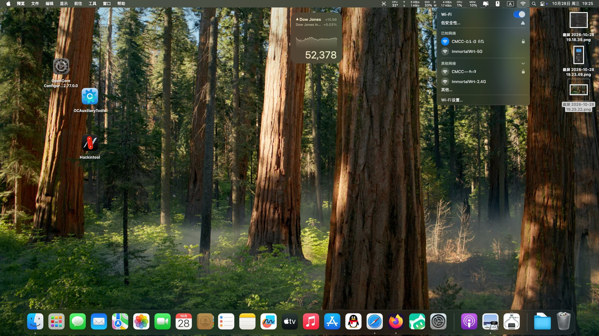
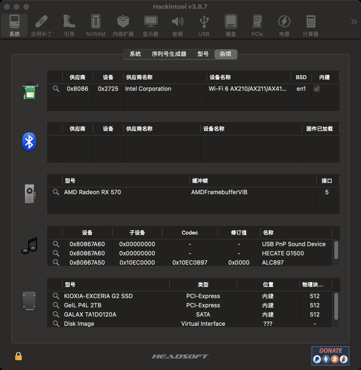
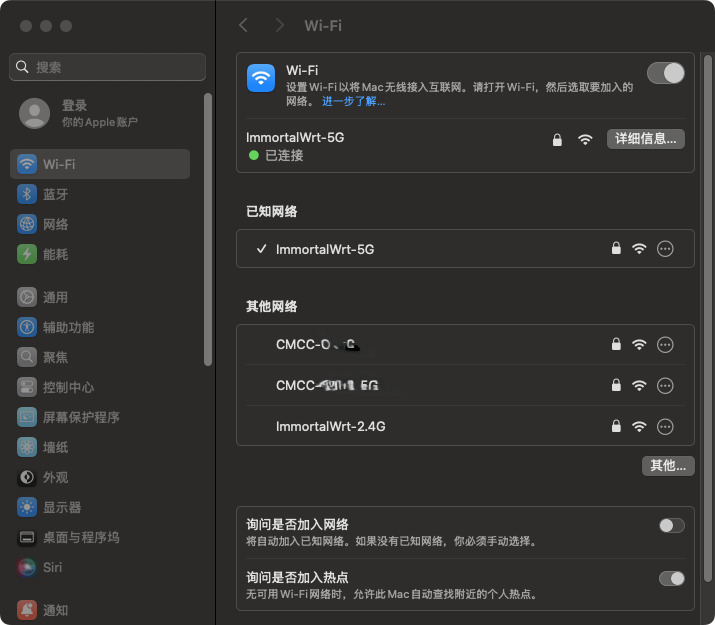
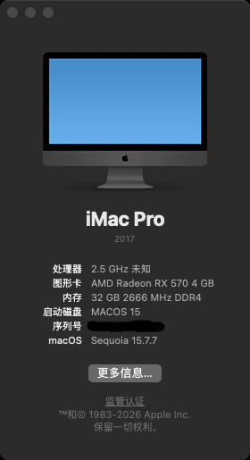

<div align="center">

# EFI-Hackintosh-i5-13490F-Maxsun-Terminator-B760M-D4-RX570

**铭瑄终结者 B760M D4 · i5-13490F · RX 570 · AX210 的 macOS Sequoia OpenCore EFI**

English: OpenCore EFI for Maxsun Terminator B760M D4 with Intel i5-13490F (Raptor Lake), AMD RX 570 (Polaris) and Intel AX210.


</div>

---

## 简介

这是一套在下列硬件上**从做盘、安装到进桌面全程实测**的 OpenCore EFI。

- OpenCore **1.0.0**，图形引导菜单（OpenCanopy + GoldenGate 主题，带图标卡片和鼠标）
- SMBIOS `iMacPro1,1`（无核显纯独显机型），**config 已脱敏**——序列号 / MLB / UUID / ROM 全部清空，请自行用 [GenSMBIOS](https://github.com/corpnewt/GenSMBIOS) 生成
- AX210 的 Wi-Fi 提供**两种方案**：方案 A 可用系统**原生 Wi-Fi 界面**（无需 OCLP、无需 HeliPort）

## 硬件配置

| 部件   | 型号                                             | macOS 支持情况               |
| ---- | ---------------------------------------------- | ------------------------ |
| 主板   | 铭瑄 MS-Terminator B760M D4（AMI BIOS）            | —                        |
| CPU  | Intel i5-13490F（Raptor Lake，6P+4E/16T，**无核显**） | 伪装 Comet Lake 后由 XCPM 管理 |
| 显卡   | AMD Radeon RX 570 4GB（Polaris 10）              | 免驱，Metal 正常，无 HEVC 硬编码   |
| 无线网卡 | Intel AX210（Wi-Fi 6E + 蓝牙 5.3）                 | 见下文 Wi-Fi 章节             |
| 有线网卡 | Realtek RTL8125 2.5G                           | LucyRTL8125Ethernet 驱动   |
| 声卡   | Realtek ALC897                                 | AppleALC，layout-id 11    |
| 硬盘   | KIOXIA EXCERIA G2 1TB（NVMe，系统盘）                | 原生                       |

## 验证状态

| 功能                      |  状态 | 说明                                        |
| :---------------------- | :-: | ----------------------------------------- |
| 安装 Sequoia 15.3 (24D60) |  正常 | 全程 U 盘引导，无异常                              |
| 升级 Sequoia 15.7.1       |  正常 | 系统设置内 OTA 升级，无异常                            |
| 图形引导菜单                  |  正常 | OpenCanopy + GoldenGate，方向键/鼠标            |
| 独显加速（RX 570）            |  正常 | WhateverGreen，无需额外属性注入                    |
| 有线网卡 2.5G               |  正常 | LucyRTL8125Ethernet                       |
| Wi-Fi（AX210）            |  正常 | 方案 A：原生 Wi-Fi 界面；方案 B：HeliPort            |
| 蓝牙（AX210）               |  **未驱动** | Intel 三件套已注入但实测未工作；蓝牙走 USB 总线，大概率与 USB 端口未定制（未标记内建）有关 |
| 声音（ALC897）              |  正常 | `alcid=11`                                |
| USB                     |  可用 | `USBInjectAll` + `XhciPortLimit`，建议后期自行定制 |
| 隔空投送 / 接力 / 随航          | 不可用 | 依赖苹果原厂网卡，Intel 卡的天花板                      |
| HEVC 硬件编码               | 不可用 | Polaris 硬件限制（解码正常）                        |

## 实机截图

以下截图均来自本机实拍，**Wi-Fi 名称已打码、关于本机的序列号已遮盖**。

| 桌面与菜单栏（Wi-Fi 下拉） | Hackintool 硬件识别 |
| --- | --- |
|  |  |

| Wi-Fi（方案 A，原生界面，已连接） | 关于本机（iMac Pro 2017 · RX 570 4GB · 32GB） |
| --- | --- |
|  |  |

Hackintool 杂项页可确认关键设备都已就位：AX210（en1，内建）、RX 570（AMDFramebufferVIB，5 接口）、ALC897、KIOXIA/GeIL NVMe。

## 快速开始

### 1. BIOS 设置（开机按 Del）

| 项目                         | 设置                                       |
| -------------------------- | ---------------------------------------- |
| Secure Boot                | Disabled（顺手 Clear Secure Boot Keys）      |
| CSM / Legacy Support       | Disabled（纯 UEFI）                         |
| Above 4G Decoding          | **Enabled**                              |
| Re-Size BAR Support        | **Disabled**                             |
| VT-d / IOMMU               | Disabled                                 |
| CFG Lock                   | 有就 Disabled（没有也没事，已用 `AppleXcpmCfgLock`） |
| XHCI Hand-off / Legacy USB | Enabled                                  |
| Serial / COM Port          | Disabled                                 |
| Boot Mode                  | UEFI Only                                |

### 2. 制作安装盘

U 盘 ≥16GB，GPT 分区。

- **有 Mac**：`createinstallmedia` 做盘，然后把整个 `EFI` 文件夹拷到 U 盘的 EFI 分区，路径必须是 `U盘/EFI/BOOT/BOOTx64.efi`。
- **只有 Windows**：U 盘分一个 FAT32 分区拷入 `EFI`；再用 `tools/macrecovery` 下载恢复镜像放到 U 盘根目录（与 `EFI` 同级）：
  ```bat
  cd tools\macrecovery
  python macrecovery.py -b Mac-E43C1C25D4880AD6 -m 00000000000000000 download
  ```

### 3. 安装

1. 开机按 **F11** 选 `UEFI: <U盘名>`，进入图形菜单
2. 选 `macOS Base System` / `Install macOS Sequoia`
3. 磁盘工具把目标盘抹成 **APFS / GUID**，然后正常安装；过程中自动重启 2~3 次，每次选 **`macOS Installer`**
4. 装完把 EFI 搬到系统盘 ESP 分区

> **拷贝 EFI 的注意事项**：先删掉 ESP 上旧的 `EFI\OC` 再复制，并核对 `config.plist` 的字节数。ESP 空间不足导致的"半截拷贝"会报 `OC: Failed to load configuration!`——这不是配置坏了，是文件没拷全。

### 4. 装完必做

1. 用 GenSMBIOS 生成序列号填入 `PlatformInfo > Generic`（本包已清空）
2. USB 端口定制：用 [USBToolBox](https://github.com/USBToolBox/tool) 生成 `UTBMap.kext` 替换 `USBInjectAll`，然后关掉 `XhciPortLimit`
3. 调试日志：`Misc > Debug > Target` 设为 `19`，日志生成在 **ESP 根目录**（不在 `EFI/OC/` 里，别找错地方）

## Wi-Fi（AX210）：两种方案

### 方案 A（推荐）：原生 Wi-Fi 界面

来自 [laobamac/itlwm](https://github.com/laobamac/itlwm) 分支的 `AirportItlwm 2.4.0`，直接链接 Sequoia 原生的 `IOSkywalkFamily` + `IO80211Family`——**不需要 OCLP，不需要 HeliPort**，系统设置里就是原生 Wi-Fi。

1. 把 `可选WiFi/方案A-原生WiFi-推荐/AirportItlwm.kext` 拷进 `EFI/OC/Kexts/`
2. 删掉 `AirportItlwm_Sonoma.kext`（带 `MaxKernel=23.3.99`，Sequoia 上本来就不加载；一删一换体积持平）
3. `config-原生WiFi.plist` 改名成 `config.plist` 覆盖（条目带 `MinKernel=24.0.0`）
4. 重启，系统设置直接连 Wi-Fi

### 方案 B（备选）：itlwm + HeliPort

`可选WiFi/方案B-itlwm加HeliPort-备选/`，配合 [HeliPort](https://github.com/OpenIntelWireless/HeliPort/releases)。走以太网驱动栈，稳但界面简陋：系统设置的 Wi-Fi 开关无效。

**蓝牙**（如实说明）：`IntelBluetoothFirmware 2.5.0` + `IntelBTPatcher 2.5.0` + `BlueToolFixup 2.6.9` 三件套已注入，但**实测未驱动**。蓝牙走 USB 总线，最常见的未驱动原因就是 USB 端口未定制（蓝牙口没有被标记为内建/255）。等 USB 定制完成后回来验证；也欢迎有思路的读者提 issue。注意官方 release 的 2.4.0 在 Sequoia 会被 Lilu 判定不支持，请保持 2.5.0。

## config 踩坑记录（这套机器的真实血泪）

把在这块板上**实际踩过**的坑写下来，省得后来人再趟一遍：

| 坑                            | 现象                                            | 正确姿势                                                                                     |                                     |
| ---------------------------- | --------------------------------------------- | ---------------------------------------------------------------------------------------- | ----------------------------------- |
| Booter 三件套没开                 | 卡死在 `CoreAnalyticsHub start completed`，日志戛然而止 | `DevirtualiseMmio=true` + `ProtectUefiServices=true` + `ResizeAppleGpuBars=0`，缺一个就卡      |                                     |
| 缺 `AppleMCEReporterDisabler` | 同上，内核早期无提示挂住                                  | 12/13 代必装                                                                                |                                     |
| `SetupVirtualMap=false`      | 卡死在 \`[EB                                     | #LOG:EXITBS:START]\`                                                                     | 这块 AMI 板必须 `true`（新固件关它的通用建议在这里不适用） |
| `SSDT-PLUG` 类型不匹配            | 静默失效                                          | 这块板 CPU 是 Device 型（`\_SB.PR00`，ACPI0007），普通 PLUG 的 `ObjectType==0x0C` 检查会静默跳过；用 PLUG-ALT |                                     |
| OpenCore 日志找不到               | 以为没生成                                         | 日志在 **ESP 根目录**，不在 `EFI/OC/` 里；`Target` 需含 `0x10` 才写文件                                   |                                     |
| ESP 拷贝不完整                    | `OC: Failed to load configuration!`           | ESP 里还有 Windows 的 `EFI/Microsoft`（约 31MB），先删 `EFI\OC` 再拷，并核对文件字节数                        |                                     |
| Reset NVRAM 后丢启动项            | 开机直接进 Windows                                 | `LauncherOption=Full`，OpenCore 每次启动自动注册 `OpenCore` 启动项                                   |                                     |

## 目录结构

```
EFI/
├── BOOT/BOOTx64.efi
└── OC/
    ├── ACPI/       SSDT-AWAC / SSDT-EC-USBX-DESKTOP / SSDT-PLUG-ALT
    ├── Drivers/    HfsPlus / OpenRuntime / OpenCanopy / ResetNvramEntry
    ├── Kexts/      18 个（清单见下）
    ├── Resources/  OpenCanopy 主题（GoldenGate）+ Font + Label + Audio
    ├── Tools/      OpenShell.efi
    ├── OpenCore.efi
    └── config.plist
可选WiFi/
├── 方案A-原生WiFi-推荐/          AirportItlwm.kext + config-原生WiFi.plist
└── 方案B-itlwm加HeliPort-备选/    itlwm.kext + config-带itlwm.plist
tools/macrecovery/                Windows 下下载 macOS 恢复镜像
```

## Kext 清单

| Kext                                    | 版本          | 作用                         | 来源                                                                               |
| --------------------------------------- | ----------- | -------------------------- | -------------------------------------------------------------------------------- |
| Lilu                                    | 1.7.0       | 补丁框架                       | [acidanthera](https://github.com/acidanthera/Lilu)                               |
| VirtualSMC                              | 1.3.5       | SMC 模拟                     | [acidanthera](https://github.com/acidanthera/VirtualSMC)                         |
| WhateverGreen                           | 1.6.9       | 显卡补丁                       | [acidanthera](https://github.com/acidanthera/WhateverGreen)                      |
| AppleALC                                | 1.9.4       | ALC897 声卡                  | [acidanthera](https://github.com/acidanthera/AppleALC)                           |
| RestrictEvents                          | 1.1.5       | 屏蔽内存/CPU 提示                | [acidanthera](https://github.com/acidanthera/RestrictEvents)                     |
| BlueToolFixup                           | 2.6.9       | Sequoia 蓝牙栈修复              | [acidanthera/BrcmPatchRAM](https://github.com/acidanthera/BrcmPatchRAM)          |
| SMCProcessor / SMCSuperIO               | 1.3.5       | 温度 / 风扇传感器                 | VirtualSMC 套件                                                                    |
| LucyRTL8125Ethernet                     | 1.2.2       | RTL8125 2.5G 网卡            | [Mieze](https://github.com/Mieze/RTL8125-Mac-Driver)                             |
| IntelBluetoothFirmware / IntelBTPatcher | 2.5.0       | Intel 蓝牙                   | [OpenIntelWireless](https://github.com/OpenIntelWireless/IntelBluetoothFirmware) |
| CPUFriend + DataProvider                | 1.2.7       | CPU 变频策略                   | [acidanthera/CPUFriend](https://github.com/acidanthera/CPUFriend)                |
| USBInjectAll                            | 0.8.0       | USB 端口注入（临时）               | [RehabMan](https://github.com/RehabMan/OS-X-USB-Inject-All)                      |
| AppleMCEReporterDisabler                | 1.2         | 禁用 MCE Reporter（12/13 代必需） | 社区                                                                               |
| Innie                                   | 1.3.1       | PCIe 设备标记为内置               | [ic005k/Innie](https://github.com/cdf/Innie)                                     |
| SMCRadeonSensors                        | 2.3.0       | GPU 温度传感器                  | [ChefKiss](https://github.com/ChefKiss/SMCRadeonSensors)                         |
| AirportItlwm（可选WiFi 方案A）                | 2.4.0-alpha | AX210 原生 Wi-Fi             | [laobamac/itlwm](https://github.com/laobamac/itlwm)                              |
| itlwm（可选WiFi 方案B）                       | 2.3.0       | AX210 Wi-Fi（HeliPort）      | [OpenIntelWireless/itlwm](https://github.com/OpenIntelWireless/itlwm)            |

## 排错速查

| 症状                                   | 处理                                                      |                           |
| ------------------------------------ | ------------------------------------------------------- | ------------------------- |
| 卡 \`[EB                              | #LOG:EXITBS:START]\`                                    | 确认 `SetupVirtualMap=true` |
| 卡 `CoreAnalyticsHub start completed` | 确认 Booter 三件套 + `AppleMCEReporterDisabler`；等 5 分钟确认不是假死 |                           |
| `OC: Failed to load configuration!`  | EFI 没拷全，先删 `EFI\OC` 再拷并核对字节数                            |                           |
| `still waiting for root device`      | U 盘插到第 15 个端口之后了，换后置 USB 2.0 口                          |                           |
| 无声                                   | `alcid=11` 依次换 `12 / 66 / 69 / 98 / 99`                 |                           |
| 蓝牙灰色                                 | 确认三个 Intel 蓝牙 kext 启用、`SecureBootModel=Disabled`        |                           |
| Reset NVRAM 后丢 OC 启动项                | 确认 `LauncherOption=Full`                                |                           |

## 更新日志

| 日期         | 内容                                                  |
| ---------- | --------------------------------------------------- |
| 2026-10-25 | 初版：基于实测可启动的 EFI，加 `LauncherOption=Full` 与 Wi-Fi 双方案 |
| 2026-10-28 | 首次公开发布，序列号脱敏，补齐文档                                   |

## 致谢

[acidanthera](https://github.com/acidanthera)（OpenCore / Lilu / VirtualSMC / WhateverGreen / AppleALC / BrcmPatchRAM / OcBinaryData）、  
[OpenIntelWireless](https://github.com/OpenIntelWireless)（itlwm / AirportItlwm / HeliPort / IntelBluetoothFirmware）、  
[laobamac](https://github.com/laobamac/itlwm)（Sequoia/Tahoe 原生 AirportItlwm）、  
[Mieze](https://github.com/Mieze)（Realtek 2.5G 驱动）、  
[RehabMan](https://github.com/RehabMan)、  
[Cheap-Coder/Innie](https://github.com/cdf/Innie)、  
[ChefKiss](https://github.com/ChefKiss/SMCRadeonSensors)、  
[Dortania](https://dortania.github.io/OpenCore-Install-Guide/)（文档）、  
以及 B 站 UP 主与各 hackintosh 社区的经验帖。

## 免责声明

本项目仅供个人学习研究使用。请自行遵守 Apple 最终用户许可协议；本仓库不包含、也不分发任何 Apple 操作系统镜像。所引用的 OpenCore、kext 等组件版权归各自作者所有，详见上方清单中的原始仓库。
