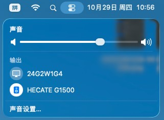

<div align="center">

# EFI-Hackintosh-i5-13490F-Maxsun-Terminator-B760M-D4-RX570

**铭瑄终结者 B760M D4 · i5-13490F · RX 570 · AX210 的 macOS Tahoe OpenCore EFI**

English: OpenCore EFI for Maxsun Terminator B760M D4 with Intel i5-13490F (Raptor Lake), AMD RX 570 (Polaris) and Intel AX210 — running macOS Tahoe 26.


</div>

---

## 简介

这是一套在下列硬件上**从做盘、安装到日常使用全程实测**的 OpenCore EFI，当前版本已在 **macOS Tahoe 26.7.1** 上跑通，包括之前一直没搞定的 **USB 端口定制**和 **Intel 蓝牙**。

- OpenCore **1.0.8**，图形引导菜单（OpenCanopy + GoldenGate 主题，含 macOS 26 官方图标）
- SMBIOS **`MacPro7,1`**（无核显纯独显机型）。**config 已脱敏**——序列号 / MLB / UUID / ROM 全部清空，请自行用 [GenSMBIOS](https://github.com/corpnewt/GenSMBIOS) 生成
- **USB 端口表自建 15 口**（`USBPorts.kext`），后置 hub、前置 USB3、蓝牙全部可用
- **蓝牙已修复**：AX210 在 Tahoe 上必须加 `-ibtcompatbeta` + `BlueToolFixup 2.7.2`
- AX210 的 Wi-Fi 走 `AirportItlwm`，系统设置里是**原生 Wi-Fi 界面**（无需 OCLP、无需 HeliPort）

## 硬件配置

| 部件 | 型号 | macOS 支持情况 |
| --- | --- | --- |
| 主板 | 铭瑄 MS-Terminator B760M D4（AMI BIOS） | — |
| CPU | Intel i5-13490F（Raptor Lake，6P+4E / 10 核 16 线程，**无核显**） | XCPM 原生电源管理 |
| 显卡 | AMD Radeon RX 570 4GB（Polaris 10） | 免驱，Metal 正常，无 HEVC 硬编码 |
| 内存 | 32 GB DDR4 2666 | 正常识别 |
| 无线网卡 | Intel AX210（Wi-Fi 6E + 蓝牙 5.3） | Wi-Fi 用 AirportItlwm，蓝牙需 `-ibtcompatbeta` |
| 有线网卡 | Realtek RTL8125 2.5G | LucyRTL8125Ethernet |
| 声卡 | Realtek ALC897 | AppleALC，`alcid=11` |
| 系统盘 | 2 TB（Tahoe 在 161 GB APFS 容器内） | 原生 |
| 引导盘 | 120 GB SSD（ESP 209.7 MB） | — |

> 本机的 ESP 在 120 GB SSD 上，2 TB 系统盘**没有 EFI 分区**——开机依赖那块 SSD 在位，别随手拔。

## 验证状态

| 功能 | 状态 | 说明 |
| :-- | :-: | :-- |
| 安装 macOS 26.7.1 (25G241) | 正常 | 全程 U 盘引导，无异常 |
| 图形引导菜单 | 正常 | OpenCanopy + GoldenGate，macOS 26 官方图标 |
| 独显加速（RX 570） | 正常 | WhateverGreen，无需 `agdpmod=pikera`（那是 Navi 专用） |
| 有线网卡 2.5G | 正常 | LucyRTL8125Ethernet |
| Wi-Fi（AX210） | 正常 | 原生界面，5 GHz 160 MHz / 802.11ac / 1732 Mbps |
| 蓝牙（AX210） | 正常 | **`-ibtcompatbeta` 是关键**，详见下文 |
| 声音（ALC897） | 正常 | `alcid=11`；USB 声卡、HDMI 音频同时可用 |
| 处理器名称 | 正常 | 关于本机显示 `Intel Core i5-13490F` |
| USB 端口 | 正常 | 自建 15 口，后置 hub / 前面板 USB3 全通 |
| 隔空投送 / 接力 / 随航 | 不可用 | 依赖苹果原厂网卡，Intel 卡的天花板 |
| HEVC 硬件编码 | 不可用 | Polaris 硬件限制（解码正常） |

## 实机截图

截图均来自本机实拍；**序列号与 MAC 地址已打码**。

| 关于本机（Mac Pro 2019 · i5-13490F · RX 570） | Wi-Fi（原生界面，已连接 5 GHz） |
| --- | --- |
|  |  |

| 蓝牙（AirPods Pro + HECATE G1500） | 声音输出（显示器音频 + USB 声卡） |
| --- | --- |
|  |  |

| 桌面 | Hackintool 设备识别 |
| --- | --- |
|  |  |

## 快速开始

### 1. BIOS 设置（开机按 Del）

| 项目 | 设置 |
| --- | --- |
| Secure Boot | Disabled（顺手 Clear Secure Boot Keys） |
| CSM / Legacy Support | Disabled（纯 UEFI） |
| Above 4G Decoding | **Enabled** |
| Re-Size BAR Support | **Disabled** |
| VT-d / IOMMU | Disabled |
| CFG Lock | 有就 Disabled（没有也没事，已用 `AppleXcpmCfgLock`） |
| XHCI Hand-off / Legacy USB | Enabled |
| Serial / COM Port | Disabled |
| Boot Mode | UEFI Only |

### 2. 制作安装盘

U 盘 ≥16GB，GPT 分区。

- **有 Mac**：`createinstallmedia` 做盘，然后把整个 `EFI` 文件夹拷到 U 盘的 EFI 分区，路径必须是 `U盘/EFI/BOOT/BOOTx64.efi`。
- **只有 Windows**：U 盘分一个 FAT32 分区拷入 `EFI`；再用 `tools/macrecovery` 下载恢复镜像放到 U 盘根目录（与 `EFI` 同级）：
  ```bat
  cd tools\macrecovery
  python macrecovery.py -b Mac-E43C1C25D4880AD6 -m 00000000000000000 download
  ```

### 3. 安装

1. 开机按 **F11** 选 `UEFI: <U盘名>`，进入图形菜单
2. 选 `macOS Base System` / `Install macOS Tahoe`
3. 磁盘工具把目标盘抹成 **APFS / GUID**，然后正常安装；过程中自动重启 2~3 次，每次选 **`macOS Installer`**
4. 装完把 EFI 搬到系统盘 ESP 分区

> **拷贝 EFI 的注意事项**：先删掉 ESP 上旧的 `EFI\OC` 再复制，并核对 `config.plist` 的字节数。ESP 空间不足导致的"半截拷贝"会报 `OC: Failed to load configuration!`——这不是配置坏了，是文件没拷全。

### 4. 装完必做

1. 用 GenSMBIOS 生成序列号填入 `PlatformInfo > Generic`（本包已清空）
2. 确认 `NVRAM > Add > 4D1FDA02-…` 里的 `revcpuname` 改成你自己的 CPU 名称
3. 调试日志：`Misc > Debug > Target` 设为 `19`，日志生成在 **ESP 根目录**（不在 `EFI/OC/` 里，别找错地方）

## USB 端口定制（本次最大的坑）

Tahoe 上**端口表写不对 = 整张表被丢弃**，而且不会报错，只表现为"某些口就是不认"。本机是 XHCI 26 个口，macOS 只允许 15 个，所以必须先做减法。

### 生效的关键四条

1. **只用新键**：`usb-port-number` + `usb-port-type`，**绝对不能同时保留旧的 `port` / `UsbConnector`**。Tahoe 一看到旧键就回退旧解析逻辑，整表作废（Hackintool 老格式就是这么全灭的）。
2. **bundle id 必须独立**：用 `com.wb.USBPorts`，不要沿用 `com.apple.driver.AppleUSBHostMergeProperties`——Tahoe 自带同名同 id 的插件 kext，撞车会被当重复项跳过。
3. **整个 kext 删掉重建**，不要在旧 `Info.plist` 上改；顺手清掉 FAT32 生成的 `._*` 资源叉文件。
4. 匹配方式用 `IOProviderClass = AppleUSBHostController` + `IONameMatch = XHCI` + `model`（MacPro7,1 / iMacPro1,1 两个 personality 都写）。

### 本机 15 口分配

| 端口 | 用途 | 类型 |
| --- | --- | --- |
| HS03 | 后置 hub + USB 声卡 | 3 |
| HS04 ~ HS08 | 后置 USB 2.0 | 3 |
| HS07 | HECATE G1500 音箱 | 3 |
| HS09 | 鼠标（前面板 USB3 的 2.0 线） | 3 |
| HS10 | 后置 USB 2.0 | 3 |
| HS11 | 后置 USB 2.0 hub（键盘接这里） | 3 |
| HS14 | **蓝牙（必须标内建）** | **255** |
| SS01 ~ SS04 | 后置 USB 3.x | 3 |
| SS09 | 前面板 USB3 | 3 |

`port-count` 仍写 26（对应控制器真实端口数）。被裁掉的是 HS01/HS02(灯效)/HS12/HS13、USR1/USR2、SS05~SS08/SS10——需要的话拿上面不用的口去换。

### 判定是否生效

进系统后看 ioreg：XHCI 节点上应出现 `"ports"`、`"port-count"` 和自建的探针键（本包是 `wb-probe`），端口节点数应为 15。三者缺一，就是没合并进去。

## 蓝牙（AX210）——为什么以前一直不行

三件套 `IntelBluetoothFirmware / IntelBTPatcher / BlueToolFixup` 早就注入了，但 Tahoe 上依旧是"开关打不开、地址 NULL"。

**根因**：`IntelBTPatcher` 的 `PluginConfiguration` 里最高支持内核版本写的是 **Sequoia**，在 Tahoe 上会被 Lilu 直接拦下不加载；而它负责给 AX210（`0x8087:0x0032`）做固件上传补丁。补丁缺失 → `IntelBluetoothFirmware` 匹配到设备但 `start()` 失败（ioreg 里能看到 `!registered, !matched`）→ 固件没上传 → 系统退回占位状态（`Chipset: BCM_4350C2`、`FW v0`）。

**解决**（上游 2026-01 才在 master 里补上 Tahoe 支持，正式版还没发）：

```
boot-args  += -ibtcompatbeta          # 这是 IntelBTPatcher 自带的 beta 开关
BlueToolFixup  2.6.9 → 2.7.2          # 2.6.9 发布早于 Tahoe
```

`-ibtcompatbeta` 是 kext 二进制里预留的正规参数（另有 `-ibtcompatdbg` / `-ibtcompatoff`），不用改二进制。加上之后蓝牙立刻正常，AirPods Pro 与 HECATE G1500 都能连。

`NVRAM` 里另外两个键也保留着（部分机器需要）：

```
bluetoothExternalDongleFailed      = 00
bluetoothInternalControllerInfo    = 0000000000000000000000000000
```

## 处理器名称显示"未知"

Tahoe 的处理器名是从 `AppleSystemInfo.framework/.../Resources/Processors.loctable` 查出来的，键长这样：`"10-Core Intel Xeon W"`、`"Intel Core i5"`。**查不到就显示"未知"**。

要显示真实型号，需要三件事同时成立：

```
PlatformInfo → Generic → ProcessorType = 3841 (0x0F01)   # 处理器族设成 Xeon W，先让查表命中
PlatformInfo → SMBIOS  → ProcessorType = 3841
boot-args  += revcpu=1                                    # RestrictEvents 的替换开关（Intel 上默认关）
NVRAM  revcpuname = Intel Core i5-13490F                  # 通过 4D1FDA02-… 这个 GUID 写入
```

原理：`revcpu=1` 打开后，RestrictEvents 会在代码签名钩子里把 `AppleSystemInfo` 中的 `"10-Core Intel Xeon W"`（按你实际核心数算出来的基准串）替换成 `revcpuname`。如果 `ProcessorType` 是 0，基准串压根查不出来，替换自然无效——这是之前加了 `revcpu` 也不管用的原因。

## 引导菜单图标

OpenCanopy 是按**系统主版本号**找图标的：`Apple11` / `Apple14`（Sonoma）/ `Apple15`（Sequoia）……macOS 26 需要 `Apple26.icns`，缺了就退回通用硬盘图标。

本包已放入官方图标（直接从安装器里取的，比抓官网图片清晰）：

```
/Applications/Install macOS Tahoe.app/Contents/Resources/ProductPageIcon.icns
→ Resources/image/Acidanthera/GoldenGate/Apple26.icns（另备 Apple16/Apple.icns 兜底）
```

换其他版本同理：把对应版本的官方 icns 改名成 `Apple<主版本>.icns` 丢进去即可。

## config 踩坑记录（这套机器的真实血泪）

| 坑 | 现象 | 正确姿势 |
| --- | --- | --- |
| Booter 三件套没开 | 卡死 `CoreAnalyticsHub start completed`，日志戛然而止 | `DevirtualiseMmio` + `ProtectUefiServices` + `ResizeAppleGpuBars=0`，缺一个就卡 |
| 缺 `AppleMCEReporterDisabler` | 同上，内核早期无提示挂住 | 12/13 代必装 |
| `SetupVirtualMap=false` | 卡死 `[EB&#124;#LOG:EXITBS:START]` | 这块 AMI 板必须 `true` |
| `SSDT-PLUG` 类型不匹配 | 静默失效 | 这块板 CPU 是 Device 型（`\_SB.PR00`，ACPI0007），用 `SSDT-PLUG-ALT` |
| SMBIOS 用了 iMacPro1,1 | 开机 🚫 禁止符号 | Tahoe 的 `PlatformSupport.plist` 白名单里没有 iMacPro1,1，改 **MacPro7,1** |
| 端口表用旧键名 | 端口"消失"，键盘鼠标全灭 | 见上文 USB 章节：只写 `usb-port-number` / `usb-port-type` |
| kext 用了苹果的 bundle id | 端口表合并静默失效 | 改成独立 id（本包 `com.wb.USBPorts`） |
| `IntelBTPatcher` 无 Tahoe 上限 | 蓝牙开关打不开 | `-ibtcompatbeta` |
| `ProcessorType = 0` | 关于本机显示"未知" | 设为 3841 再配 `revcpu=1` |
| 缺 `Apple26.icns` | 引导菜单 Tahoe 是硬盘图标 | 见上文图标章节 |
| OpenCore 日志找不到 | 以为没生成 | release 版不写日志；换 DEBUG 版且 `Misc > Debug > DisplayLevel` 要放开（`0xFFFFFFFF`），日志在 **ESP 根目录** |
| ESP 拷贝不完整 | `OC: Failed to load configuration!` | 先删 `EFI\OC` 再拷，核对字节数 |
| Reset NVRAM 后丢启动项 | 开机直接进 Windows | `LauncherOption=Full` |

## 目录结构

```
EFI/
├── BOOT/BOOTx64.efi
└── OC/
    ├── ACPI/       SSDT-AWAC / SSDT-EC-USBX-DESKTOP / SSDT-PLUG-ALT
    ├── Drivers/    HfsPlus / OpenRuntime / OpenCanopy / ResetNvramEntry
    ├── Kexts/      18 个（清单见下，含自建 USBPorts.kext）
    ├── Resources/  OpenCanopy 主题（GoldenGate）+ Font + Label + Audio
    ├── Tools/      OpenShell.efi
    ├── OpenCore.efi
    └── config.plist
可选WiFi/                           历史方案，Tahoe 版已内置到 EFI，仅 Sequoia 参考
tools/macrecovery/                  Windows 下下载 macOS 恢复镜像
docs/screenshots/                   实机截图
```

## Kext 清单

| Kext | 版本 | 作用 | 来源 |
| --- | --- | --- | --- |
| Lilu | 1.7.2 | 补丁框架 | [acidanthera](https://github.com/acidanthera/Lilu) |
| VirtualSMC | 1.3.8 | SMC 模拟 | [acidanthera](https://github.com/acidanthera/VirtualSMC) |
| WhateverGreen | 1.7.1 | 显卡补丁 | [acidanthera](https://github.com/acidanthera/WhateverGreen) |
| AppleALC | 1.9.4 | ALC897 声卡 | [acidanthera](https://github.com/acidanthera/AppleALC) |
| RestrictEvents | 1.1.6 | 屏蔽内存/PCI 提示 + CPU 名称 | [acidanthera](https://github.com/acidanthera/RestrictEvents) |
| BlueToolFixup | **2.7.2** | 蓝牙栈修复（Tahoe 必需） | [acidanthera/BrcmPatchRAM](https://github.com/acidanthera/BrcmPatchRAM) |
| SMCProcessor / SMCSuperIO | 1.3.8 | 温度 / 风扇传感器 | VirtualSMC 套件 |
| LucyRTL8125Ethernet | 1.2.2 | RTL8125 2.5G 网卡 | [Mieze](https://github.com/Mieze/RTL8125-Mac-Driver) |
| IntelBluetoothFirmware | 2.5.0 | Intel 蓝牙固件 | [OpenIntelWireless](https://github.com/OpenIntelWireless/IntelBluetoothFirmware) |
| IntelBTPatcher | 2.5.0 | 蓝牙固件上传补丁（需 `-ibtcompatbeta`） | 同上 |
| **USBPorts** | 1.0 | **自建 15 口端口表** | 本仓库 |
| AirportItlwm | 2.4.0 | AX210 原生 Wi-Fi（Tahoe） | [laobamac/itlwm](https://github.com/laobamac/itlwm) |
| CPUFriend + DataProvider | 1.2.7 | CPU 变频策略（本机 **已禁用**，原生 XCPM 更稳） | [acidanthera/CPUFriend](https://github.com/acidanthera/CPUFriend) |
| AppleMCEReporterDisabler | 1.2 | 禁用 MCE Reporter（12/13 代必需） | 社区 |
| Innie | 1.3.1 | PCIe 设备标记为内置 | [Cheap-Coder/Innie](https://github.com/cdf/Innie) |
| SMCRadeonSensors | 2.3.0 | GPU 温度传感器 | [ChefKiss](https://github.com/ChefKiss/SMCRadeonSensors) |

## 排错速查

| 症状 | 处理 |
| --- | --- |
| 卡 `[EB&#124;#LOG:EXITBS:START]` | 确认 `SetupVirtualMap=true` |
| 卡 `CoreAnalyticsHub start completed` | 确认 Booter 三件套 + `AppleMCEReporterDisabler` |
| `OC: Failed to load configuration!` | EFI 没拷全，先删 `EFI\OC` 再拷并核对字节数 |
| 开机 🚫 禁止符号 | SMBIOS 不是 MacPro7,1，或 `-no_compat_check` 丢了 |
| 某个 USB 口不认 / 键鼠全灭 | 端口表没生效，按 USB 章节核对四条；先插前面板 USB3 应急进系统 |
| 蓝牙灰色 / 打不开 | 确认 `-ibtcompatbeta` 在 boot-args 里，`BlueToolFixup` ≥ 2.7.2 |
| 关于本机显示"未知" | `ProcessorType=3841` + `revcpu=1` + NVRAM `revcpuname` |
| 引导菜单只有硬盘图标 | 缺 `Apple26.icns` |
| 无声 | `alcid=11` 依次换 `12 / 66 / 69 / 98 / 99` |
| Reset NVRAM 后丢 OC 启动项 | 确认 `LauncherOption=Full` |

## 更新日志

| 日期 | 内容 |
| --- | --- |
| 2026-10-25 | 初版：基于实测可启动的 EFI，加 `LauncherOption=Full` 与 Wi-Fi 双方案 |
| 2026-10-28 | 首次公开发布，序列号脱敏，补齐文档 |
| 2026-10-29 | **升级到 macOS Tahoe 26.7.1**：OpenCore 1.0.8 + SMBIOS 改 MacPro7,1；USB 端口表重建（15 口，Tahoe 新键）；蓝牙修复（`-ibtcompatbeta` + BlueToolFixup 2.7.2）；处理器名称修复（`revcpu=1` + `revcpuname` + `ProcessorType`）；引导菜单改用官方 Tahoe 图标；RestrictEvents 升 1.1.6 |

## 致谢

[acidanthera](https://github.com/acidanthera)（OpenCore / Lilu / VirtualSMC / WhateverGreen / AppleALC / BrcmPatchRAM / RestrictEvents / OcBinaryData）、  
[OpenIntelWireless](https://github.com/OpenIntelWireless)（itlwm / AirportItlwm / IntelBluetoothFirmware）、  
[laobamac](https://github.com/laobamac/itlwm)（Tahoe 原生 AirportItlwm）、  
[corpnewt](https://github.com/corpnewt)（USBMap / GenSMBIOS，本项目的端口表思路来自 USBMap 源码）、  
[Mieze](https://github.com/Mieze)（Realtek 2.5G 驱动）、  
[RehabMan](https://github.com/RehabMan)、  
[Cheap-Coder/Innie](https://github.com/cdf/Innie)、  
[ChefKiss](https://github.com/ChefKiss/SMCRadeonSensors)、  
[Dortania](https://dortania.github.io/OpenCore-Install-Guide/)（文档）、  
以及 B 站 UP 主与各 hackintosh 社区的经验帖。

## 免责声明

本项目仅供个人学习研究使用。请自行遵守 Apple 最终用户许可协议；本仓库不包含、也不分发任何 Apple 操作系统镜像。所引用的 OpenCore、kext 等组件版权归各自作者所有，详见上方清单中的原始仓库。
