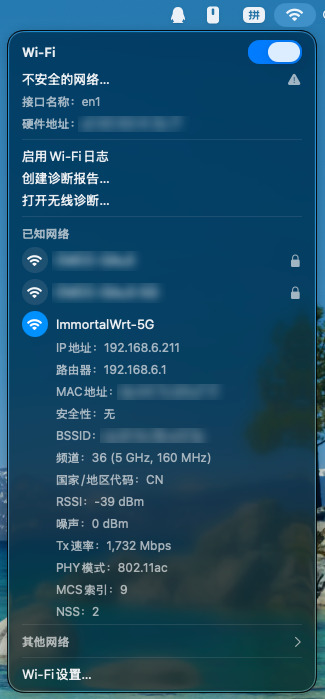
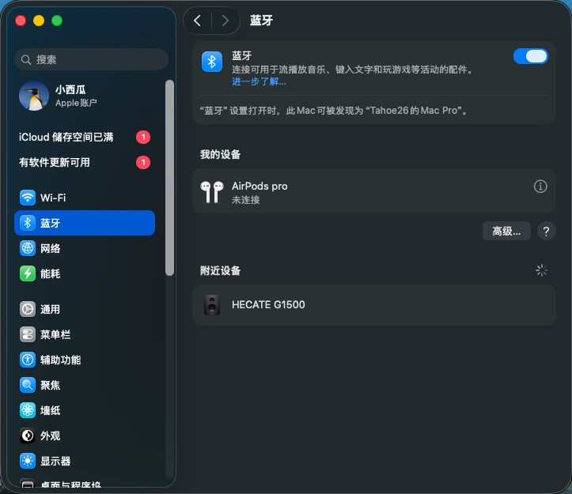

<div align="center">

# Maxsun B760M 13490F D4 Hackintosh

**铭瑄终结者 B760M D4 · i5-13490F · RX 570 · AX210 的 macOS Tahoe OpenCore EFI**

     

[English](README.md) &nbsp;·&nbsp; **简体中文**

</div>

---

## 简介

一套在入门级 Raptor Lake 平台、Polaris 显卡与 Intel AX210 网卡上跑通的 OpenCore EFI。下面写的每一条结论都在实机上验证过，不是照着模板抄的。

这个仓库值得一看的地方在于：有三件事在旧版 macOS 上「本来就好好的」，到 Tahoe 上却静悄悄地坏了，而且**一条报错都不给**。

| 表现出来的症状 | 真正的原因 |
| --- | --- |
| 部分 USB 口怎么都不出现 | 端口表用了旧属性名，Tahoe 直接整表丢弃 |
| 蓝牙打不开，系统显示 `BCM_4350C2 / v0` | 固件上传环节被卡住，因为负责打补丁的 kext 在 macOS 26 上不加载 |
| 关于本机里处理器显示「未知」 | SMBIOS 的处理器族是 `0`，名称查表必然落空 |

三者的根因与解法都写在 [原理与踩坑](#原理与踩坑) 里。

仓库里的 `config.plist` **已脱敏**：序列号、MLB、UUID、ROM 全部留空。开机前请用 [GenSMBIOS](https://github.com/corpnewt/GenSMBIOS) 自己生成一份。

## 硬件配置

| 部件 | 型号 | macOS 支持情况 |
| --- | --- | --- |
| 主板 | 铭瑄 MS-Terminator B760M D4（AMI BIOS） | — |
| CPU | Intel Core i5-13490F（Raptor Lake，6P + 4E，10 核 16 线程，**无核显**） | XCPM 原生电源管理 |
| 显卡 | AMD Radeon RX 570 4 GB（Polaris 10） | 免驱，Metal 正常，无 HEVC 硬件编码 |
| 内存 | 32 GB DDR4-2666 | 正常识别 |
| 无线网卡 | Intel AX210（Wi-Fi 6E + 蓝牙 5.3） | Wi-Fi 用 `AirportItlwm`，蓝牙需 `-ibtcompatbeta` |
| 有线网卡 | Realtek RTL8125 2.5G | `LucyRTL8125Ethernet` |
| 声卡 | Realtek ALC897 | `AppleALC`，`alcid=11` |
| 系统盘 | 2 TB，Tahoe 位于 161 GB 的 APFS 容器内 | 原生 |
| 引导盘 | 120 GB SSD，ESP 209.7 MB | — |

> 引导用的 ESP 在 120 GB 那块 SSD 上，2 TB 系统盘**没有 EFI 分区**。那块 SSD 一旦拔掉就开不了机，别随手拆。

## 功能验证

| 功能 | 状态 | 说明 |
| --- | --- | --- |
| 安装 macOS Tahoe 26.7.1（25G241） | 正常 | U 盘全程引导，没有额外绕路 |
| 图形引导菜单 | 正常 | OpenCanopy + GoldenGate 主题，官方 macOS 26 图标 |
| 独显加速（RX 570） | 正常 | `WhateverGreen`；**不需要** `agdpmod=pikera`（那是 Navi 专用参数） |
| 有线网卡 2.5G | 正常 | `LucyRTL8125Ethernet` |
| Wi-Fi（AX210） | 正常 | 原生系统界面，5 GHz / 160 MHz / 802.11ac / 1732 Mbps |
| 蓝牙（AX210） | 正常 | 关键是 `-ibtcompatbeta`，详见 [Intel 蓝牙](#2-intel-蓝牙ax210) |
| 声音（ALC897） | 正常 | `alcid=11`；USB 声卡与 HDMI 音频可同时使用 |
| 处理器名称 | 正常 | 关于本机显示 `Intel Core i5-13490F` |
| USB 端口 | 正常 | 自建 15 口，后置 hub、前置 USB3、蓝牙全部可用 |
| 隔空投送 / 接力 / 随航 | 不可用 | 依赖苹果原厂网卡，这是 Intel 卡的天花板 |
| HEVC 硬件编码 | 不可用 | Polaris 硬件限制；解码正常 |

## 实机截图

截图均出自本机。**序列号、MAC 地址、网络名称已打码。**

| Wi-Fi — 原生界面，5 GHz / 160 MHz / 802.11ac | 关于本机 — Mac Pro (2019) · i5-13490F · RX 570 |
| --- | --- |
|  |  |

| 蓝牙 — AirPods Pro + HECATE G1500 | 声音输出 — 显示器音频 + USB 声卡 |
| --- | --- |
|  |  |

## 快速开始

### 1. BIOS 设置（开机按 Del）

| 项目 | 设置 |
| --- | --- |
| Secure Boot | Disabled（顺手把 Secure Boot Keys 清掉） |
| CSM / Legacy Support | Disabled（纯 UEFI） |
| Above 4G Decoding | **Enabled** |
| Re-Size BAR Support | **Disabled** |
| VT-d / IOMMU | Disabled |
| CFG Lock | 有该项就 Disabled；没有也不影响，`AppleXcpmCfgLock` 已经顶上 |
| XHCI Hand-off / Legacy USB | Enabled |
| Serial / COM Port | Disabled |
| Boot Mode | 仅 UEFI |

### 2. 制作安装盘

U 盘 ≥ 16 GB，GPT 分区。

**有 Mac**：用 `createinstallmedia` 做好安装盘，再把整个 `EFI` 文件夹拷到 U 盘的 EFI 分区，最终路径必须是 `U盘/EFI/BOOT/BOOTx64.efi`。

**只有 Windows**：在 U 盘上分一个 FAT32 分区，把 `EFI` 拷进去；然后用仓库自带的脚本下载恢复镜像，放到 U 盘根目录、与 `EFI` 同级：

```bat
cd tools\macrecovery
python macrecovery.py -b Mac-E43C1C25D4880AD6 -m 00000000000000000 download
```

### 3. 安装

1. 开机按 **F11**，选择 `UEFI: <你的U盘名>`，进入图形菜单
2. 选 `macOS Base System` / `Install macOS Tahoe`
3. 用磁盘工具把目标盘抹成 **APFS / GUID**，然后正常安装。过程中会自动重启两三次，每次都要选 **`macOS Installer`**
4. 装完后把 EFI 搬到系统盘的 ESP 分区

> **往 ESP 拷 EFI 时**先删掉旧的 `EFI\OC`，拷完再核对 `config.plist` 的字节数。ESP 空间不足导致的「半截拷贝」会报 `OC: Failed to load configuration!`，看着像配置坏了，其实只是文件没拷全。

### 4. 装完必做

1. 用 GenSMBIOS 生成序列号，填进 `PlatformInfo > Generic`（本仓库已清空）
2. 把 `NVRAM > Add > 4D1FDA02-…` 下的 `revcpuname` 改成你自己的 CPU 名称
3. 需要调试时把 `Misc > Debug > Target` 设为 `19`。日志写在 **ESP 根目录**，不在 `EFI/OC/` 里，别找错地方

## 原理与踩坑

### 1. Tahoe 的 USB 端口映射

这是整套配置里花时间最多的一块，也是哪怕别处都不看、这一节也值得读的部分。

主板向 XHCI 控制器暴露了 26 个端口（`HS01`–`HS14`、`USR1`/`USR2`、`SS01`–`SS10`），但 macOS 26 对每个控制器仍然只放行 **15 个**。Tahoe 上 `XhciPortLimit` 这个内核补丁已经失效，上限绕不过去，只能自己决定留哪 15 个。

要让端口表被接受，下面四条必须**同时**成立：

1. **把 kext 整个删掉重建**，不要在旧的 `Info.plist` 上改。从一个空 bundle 开始，把该有的 bundle 键补齐。
2. **只写新属性名** `usb-port-number` 与 `usb-port-type`，旧键 `port`、`UsbConnector` **一个都不能留**。Tahoe 遇到旧键不是「忽略」，而是退回旧的解析逻辑、把整张表丢掉，且完全不记日志。
3. **给 kext 一个独立的 bundle id**（`com.wb.USBPorts`）。Tahoe 自带一个 `AppleUSBHostMergeProperties.kext`，位于 `IOUSBHostFamily.kext/Contents/PlugIns/`，其 id 正是 `com.apple.driver.AppleUSBHostMergeProperties`，沿用同一个 id 会被当成系统已有同名 kext。
4. **按官方工具的匹配方式写 personality**：`IOProviderClass = AppleUSBHostController`、`IONameMatch = XHCI`，再加 `model` 字段；同时清掉 macOS 在 FAT32 上留下的 `._*` 资源叉文件，否则 bundle 解析不出来。

本机保留的 15 个端口：

| 端口 | 数量 | 用途 |
| --- | --- | --- |
| `HS03`–`HS11` | 9 | 后置 USB 2.0；目前键盘在 `HS07`、鼠标在 `HS09` |
| `HS14` | 1 | 蓝牙，声明为内置（`usb-port-type = 255`） |
| `SS01`–`SS04` | 4 | 后置 USB 3.0 |
| `SS09` | 1 | 前面板 USB 3.0 |

于是 `HS01`、`HS02`（主板 ARGB 灯效）、`HS12`、`HS13`、`USR1`、`USR2` 与 `SS05`–`SS10` 都不在表内。**去掉 `SS09` 的话，前面板 USB3 口只能跑 USB2 速度**——它是拿 `HS13` 的名额换回来的，端口清单之所以是现在这个样子，原因就在这里。

想确认自己的端口表有没有真的生效：

```bash
ioreg -p IOService -r -n XHCI -d 20 -l -w 0 | grep -c '"ports"'
ioreg -p IOService -r -n XHCI -d 20 -l -w 0 | grep -oE '\+-o (HS|SS|USR)[0-9]+@'
```

如果 `"ports"` 根本不出现，说明合并压根没发生、personality 没匹配上，这时候再看端口清单已经没有意义。

### 2. Intel 蓝牙（AX210）

网卡是 `0x8087:0x0032`，挂在 USB 上。Wi-Fi 免驱，蓝牙不行，而且失败现象很容易误判。系统会显示：

```
Chipset: BCM_4350C2    Firmware: v0    Address: NULL    State: Off
```

这是「固件没装载」时的占位值，并不是真的 Broadcom 芯片。看 `ioreg` 就知道卡在哪：

```
+-o IntelBluetoothFirmware  <class IntelBluetoothFirmware, !registered, !matched>
      "idVendor" = 32903 (0x8087)    "idProduct" = 50 (0x0032)
```

固件驱动匹配到了设备，但 `start()` 失败，固件始终没上传。

真正的堵点还要往前一层。`IntelBTPatcher` 在插件配置里写了一个**支持的最高内核版本**，2.5.0 这个正式版的写法停在 macOS 15，于是 Lilu 在 Tahoe 上直接拒绝加载它；固件上传补丁没打上，固件驱动跟着失败。

解法就是这个 kext 自己留的兼容开关：

```
-ibtcompatbeta
```

把它加进 `boot-args`，同时把 `BlueToolFixup` 升到 **2.7.2**（2.6.9 早于 Tahoe，patch 的 `BlueTool` 偏移量对不上）。重启后状态会变成正常值：`THIRD_PARTY_DONGLE`、固件 `v13719`。

同一个 kext 还有两个同族参数，需要时可用：`-ibtcompatdbg` 输出调试信息，`-ibtcompatoff` 彻底关掉补丁。

### 3. 处理器显示「未知」

关于本机并不直接读 CPU 品牌串。它按核心数与处理器族拼出一个键，再去查这张表：

```
/System/Library/PrivateFrameworks/AppleSystemInfo.framework/Versions/A/Resources/Processors.loctable
```

里面的条目长这样：`"10-Core Intel Xeon W"`。键查不到，这一栏就显示「未知」。本机原来的 `ProcessorType` 是 `0`（族未知），查表从一开始就不可能命中。

所以要分两步，缺一不可：

1. **让查表命中**。把 `PlatformInfo > Generic > ProcessorType` 与 `PlatformInfo > SMBIOS > ProcessorType` 都设成 `3841`（`0x0F01`，Xeon W 族）。6P + 4E 共 10 核，正好对应 `10-Core Intel Xeon W`。
2. **替换查出来的那句话**。`RestrictEvents` 会在代码签名校验时改掉 `AppleSystemInfo` 里这个本地化字符串。前提是 `revcpu=1`（这个开关在 Intel 平台上**默认是关的**），替换文本则走 NVRAM：

```
NVRAM > Add > 4D1FDA02-38C7-4A6A-9CC6-4BCCA8B30102 > revcpuname = Intel Core i5-13490F
```

`revpatch=auto` 已经包含 `cpuname`，不用另外加。名称别走 `boot-args`，里面有空格。

旁边那个 `2.5 GHz` 是对的，i5-13490F 的 P 核基频就是 2.5 GHz。

如果跳过第 1 步，`revcpu=1` 一点作用都没有——没有那句 Xeon 串可供替换。这就是最容易踩空的地方。

### 4. 引导菜单图标

GoldenGate 主题按系统版本找图标，文件名规则是 `Apple<版本号>.icns`。自带图标集止于 `Apple15`，Tahoe 找不到匹配项，就退回了通用的 `HardDrive.icns`。

官方图其实就在安装器里，不必去外面找：

```
/Volumes/Install macOS Tahoe/Install macOS Tahoe.app/Contents/Resources/ProductPageIcon.icns
```

原样拷成 `Apple26.icns`（1.6 MB，1024×1024，不做重编码），另外再复制 `Apple16.icns` 和 `Apple.icns` 兜底，防止不同 OpenCore 版本的取名规则有差异。主题由 `Misc > Boot > PickerVariant = Acidanthera\GoldenGate` 与 `PickerAttributes = 145` 指定。

## 排错速查

| 现象 | 检查方向 |
| --- | --- |
| 开机出现禁止符号 | SMBIOS 不在系统白名单里，查安装器内的 `PlatformSupport.plist` |
| `OC: Failed to load configuration!` | `config.plist` 没拷全，重新拷并比对文件大小 |
| 卡在 `[EB&#124;#LOG:EXITBS:START]` 之后 | 残留的 `-v`，或 debug/release 版本不匹配，检查 `boot-args` |
| 部分 USB 口不认 | 端口表没合并，见 [Tahoe 的 USB 端口映射](#1-tahoe-的-usb-端口映射) |
| 蓝牙关闭，显示 `BCM_4350C2 / v0` | 缺 `-ibtcompatbeta`，或 `BlueToolFixup` 版本过旧 |
| 弹出「内存模块配置不正确」 | MacPro7,1 上 `RestrictEvents` 低于 1.1.6；`revpatch=memtab` 对这个机型**无效** |
| 处理器显示「未知」 | `ProcessorType` 还是 `0`，见 [处理器显示「未知」](#3-处理器显示未知) |
| `Target=3` 却没有日志文件 | OpenCore release 版把日志代码编译掉了，要换 DEBUG 版 `OpenCore.efi` |

## 值得记住的坑

下面这些是真正在这台机器上花过时间的。

1. **Tahoe 不认 `iMacPro1,1`。** 安装器的 `PlatformSupport.plist` 只放行 `MacBookPro16,x`、`MacPro7,1` 与 `iMac20,x`。用 `iMacPro1,1` 的配置启动就是禁止符号。换成 `MacPro7,1` 并重新生成匹配的序列号。
2. **旧 USB 键会毁掉整张表。** 把 `usb-port-number` 和 `UsbConnector` 写在一起，看起来是最稳妥的兼容做法，实际会静默失败。旧键必须彻底删干净。
3. **`USBInjectAll` 在 Tahoe 上是负优化。** 它不是「少认几个口」，而是把端口枚举整个拆掉——启用后 `AppleUSBXHCIPCI` 下面**一个子节点都没有**。
4. **`XhciPortLimit` 在 Tahoe 上失效。** 15 口上限是硬限制，选端口时就得按这个前提规划。
5. **`revpatch=memtab` 对 MacPro7,1 从来没起过作用。** 这个参数是给 MacBookAir 和 MacBookPro10,x 的内存选项卡用的。MacPro7,1 上真正屏蔽告警的是 RestrictEvents 1.1.6 及以上版本里默认开启的 `revblock`。
6. **`revcpu` 在 Intel 上默认关闭**（AMD 才默认开）。只设 `revcpuname` 而不加 `revcpu=1`，等于什么都没做。
7. **release 版 OpenCore 写不出日志。** 没有 DEBUG 版本时 `Misc > Debug > Target` 是摆设，很容易让人去查一个并不存在的配置错误。
8. **`cp -R src dst` 会套一层目录。** 目标目录已存在时会变成 `EFI/EFI`，改用 `cp -R src/. dst/`。
9. **FAT32 会留 AppleDouble 文件。** ESP 上 `rm -rf` 删不掉 `._Info.plist` 这一类。用 `dot_clean` 清理并用 `ls -a` 复核；实在清不干净，就用 `newfs_msdos -v EFI -F 32` 重建分区。
10. **磁盘编号每次重启都会变。** ESP 这次是 `disk1s1`，下次可能就是 `disk2s1`。脚本里要在运行时解析挂载点，别写死。
11. **用 root 权限做的「备份」可能是空的。** 用 `sudo` 或 `with administrator privileges` 往用户主目录里拷，可能静默失败只留下一个空目录。备份完要用文件数和 `md5` 复核。
12. **`agdpmod=pikera` 只适用于 Navi。** Polaris 上加了没用，还可能黑屏。

## 目录结构

```
EFI/
  BOOT/BOOTx64.efi
  OC/
    ACPI/          SSDT-AWAC、SSDT-EC-USBX-DESKTOP、SSDT-PLUG-ALT
    Drivers/       HfsPlus、OpenCanopy、OpenRuntime、ResetNvramEntry
    Kexts/         18 个 kext（见下表）
    Resources/     OpenCanopy 主题资源，含 Apple26.icns
    Tools/         OpenShell 等
    config.plist   已脱敏，请自行生成序列号
docs/screenshots/  本文使用的截图
tools/macrecovery/ Windows 用户的恢复镜像下载脚本
可选WiFi/          早期迭代留下的两种 Wi-Fi 方案
                   （方案 A：原生 AirportItlwm；方案 B：itlwm + HeliPort）
```

## Kext 清单

| Kext | 版本 | 说明 |
| --- | --- | --- |
| Lilu | 1.7.2 | 补丁框架，其他多数 kext 依赖它 |
| VirtualSMC | 1.3.8 | SMC 模拟 |
| SMCProcessor | 1.3.8 | CPU 温度传感器 |
| SMCSuperIO | 1.3.8 | 风扇与电压传感器 |
| SMCRadeonSensors | 2.3.0 | 显卡传感器 |
| WhateverGreen | 1.7.1 | 显卡修正 |
| AppleALC | 1.9.4 | 声卡，`alcid=11` |
| AppleMCEReporterDisabler | — | 抑制非 Xeon SMBIOS 下的 MCE 崩溃 |
| RestrictEvents | 1.1.6 | 屏蔽内存/插槽通知，并处理处理器名称 |
| Innie | 1.3.1 | 让 PCIe 设备显示为内置 |
| LucyRTL8125Ethernet | 1.2.2 | 2.5G 有线网卡 |
| USBPorts | 1.0 | 自建 15 口端口表，本仓库制作 |
| AirportItlwm | 2.4.0 | Intel Wi-Fi，Tahoe 版本 |
| IntelBluetoothFirmware | 2.5.0 | 上传 AX210 固件 |
| IntelBTPatcher | 2.5.0 | 固件上传补丁，Tahoe 上需要 `-ibtcompatbeta` |
| BlueToolFixup | 2.7.2 | 修正 `BlueTool` 偏移；2.6.9 对 Tahoe 太旧 |
| CPUFriend | 1.2.7 | **已停用**——电源数据是按 12490F 生成的，与本机 CPU 不符 |
| CPUFriendDataProvider | 1.0.1 | **已停用**——同上 |

`CPUFriend` 是刻意停用的：随附的频率向量按 i5-12490F 生成，套到 13490F 上比让原生 XCPM 接管更糟。CPU 电源管理的声明由 `SSDT-PLUG-ALT` 负责。

## 更新日志

**2026-10-29 — 迁移到 Tahoe**
- OpenCore 1.0.8，SMBIOS 由 `iMacPro1,1` 改为 `MacPro7,1`（Tahoe 白名单）
- 自建 `USBPorts.kext` 替换 `USBInjectAll`：15 口、只用 Tahoe 新键、独立 bundle id
- 蓝牙修复：`-ibtcompatbeta` + `BlueToolFixup` 2.7.2
- 处理器名称修复：`ProcessorType = 0x0F01`、`revcpu=1`、NVRAM `revcpuname`
- 引导菜单换成官方 macOS 26 图标
- `RestrictEvents` 1.1.5 → 1.1.6，`AirportItlwm` 换成 Tahoe 版本
- README 重写，`config.plist` 脱敏

**更早 — Sequoia 15.7.1** — 上一版可用配置，`iMacPro1,1` + `USBInjectAll`。

## 致谢

**本仓库由这些项目拼装而成**

- [Acidanthera](https://github.com/acidanthera) — OpenCore、Lilu、VirtualSMC、WhateverGreen、AppleALC、RestrictEvents、BrcmPatchRAM
- [OpenIntelWireless](https://github.com/OpenIntelWireless) — AirportItlwm、IntelBluetoothFirmware
- [laobamac/itlwm](https://github.com/laobamac/itlwm) — 本仓库使用的 macOS 26 版 AirportItlwm 出自这个分支（2.4.0-alpha，提交 `738d4c6`）；目前 Tahoe 支持就维护在这里
- [corpnewt](https://github.com/corpnewt) — GenSMBIOS、USBMap、macrecovery
- InsanelyMac 与 r/hackintosh 社区关于 Tahoe USB 行为的讨论

**Wi-Fi 驱动内部**

`AirportItlwm.kext` 不是一个人的作品，而是一层层叠起来的。ESP 上那份的版权声明写的是 `Copyright © 2026 laobamac. Based on AirportItlwm by OpenIntelWireless.`，下面这些项目的代码都编译在里面——这台机器能连上 Wi-Fi，靠的就是它们，所以不该只出现在上游两层的 README 里：

- **[zxystd](https://github.com/zxystd)** —— itlwm / AirportItlwm 的作者；这份二进制的 bundle id 至今仍是 `com.zxystd.AirportItlwm`
- **[OpenBSD](https://github.com/openbsd/src)** —— `net80211` 以及 `iwn`、`iwm`、`iwx` 三个驱动，提供整个 802.11 协议栈与固件表（本二进制里编入了 98 条设备/固件条目）
- **[Intel](https://www.intel.com)** 与 **[Linux](https://www.kernel.org)** —— `iwlwifi` 驱动谱系与无线固件
- **[AppleIntelWiFi](https://github.com/AppleIntelWiFi)** —— Black80211-Catalina，`AppleIntelWifiAdapter` 这层模拟的源头
- **[mercurysquad](https://github.com/mercurysquad)** —— Voodoo80211，同一思路更早的一次尝试
- **[rpeshkov](https://github.com/rpeshkov)** —— black80211
- **[usr-sse2](https://github.com/usr-sse2)** —— Apple RSN Supplicant 的接入与若干缺陷修复
- **[pigworlds](https://github.com/OpenIntelWireless/itlwm/commits?author=pigworlds)** —— DVM 设备支持、MIRA 修正、MVM Gen 1 的 TX 聚合
- **[ErrorErrorError](https://github.com/ErrorErrorError)** —— UserClient 修复
- **[Acidanthera](https://github.com/acidanthera)** —— MacKernelSDK，编译这个 kext 时用到

## 免责声明

本配置仅面向与上表相同或非常接近的硬件，供参考使用。套用到其他硬件上可能导致无法开机。替换任何文件前请先备份现有 EFI，并手边留一个能用的 U 盘安装盘。风险自负。

---

### 与 Apple 无关

本项目与 **Apple Inc. 没有任何关系**，未获得 Apple 的授权、认可、赞助或支持。macOS 是 Apple Inc. 的商标，文中提到的其他商标与产品名称均归各自所有者。

本仓库提供的是一份非官方的社区配置，用于在 Apple 从未销售过的硬件上运行 macOS，仅供学习与参考，不附带任何形式的担保。如果你需要一台受官方支持的 Mac，请向 Apple 购买。
